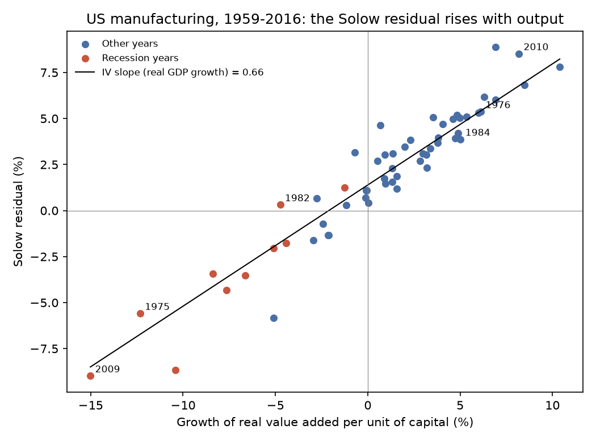
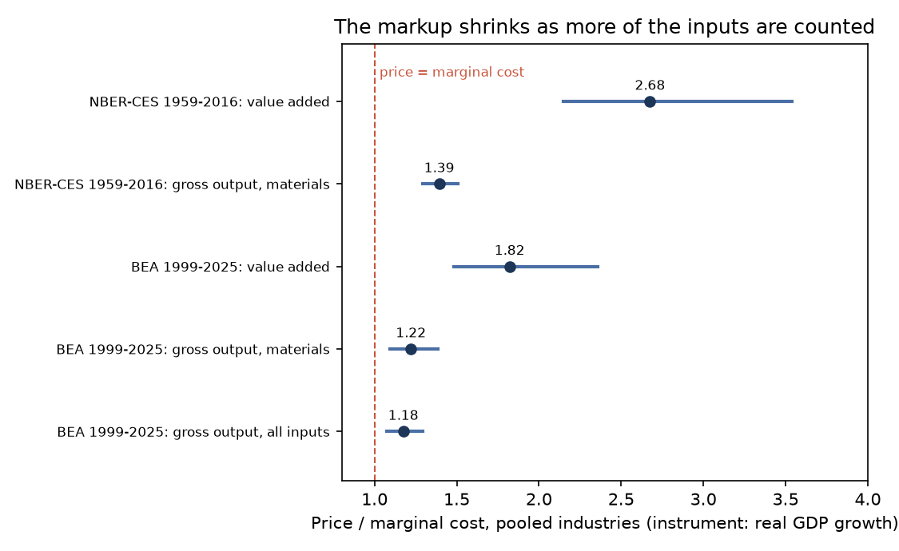
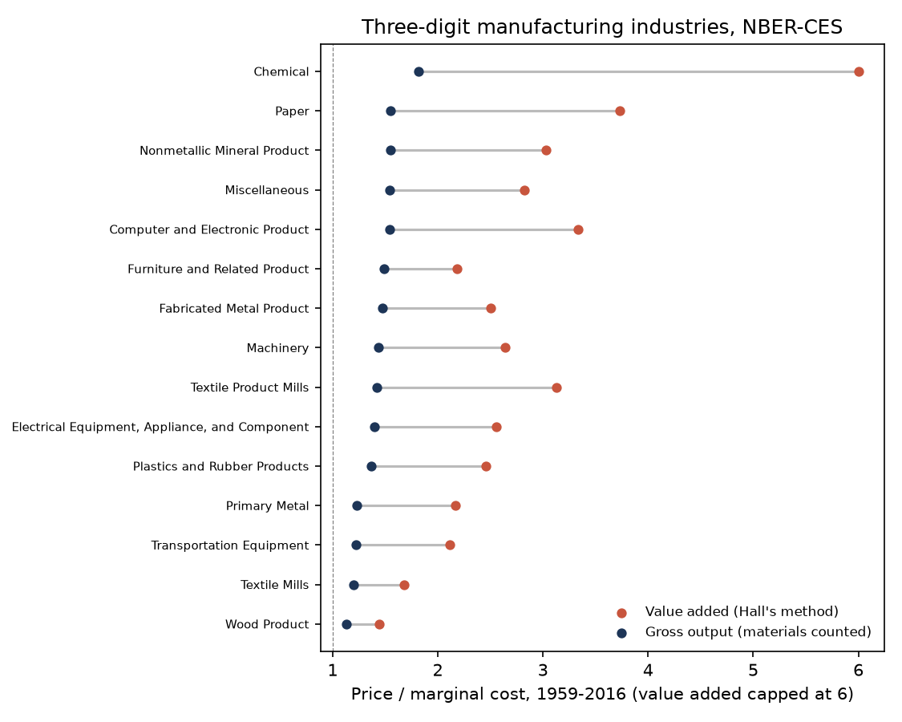

# What the Next Unit Costs

### In 1988, Robert Hall argued that American industry sells its goods for far more than it costs to make one more of them. I asked the question again with factory data running to 2016 and industry accounts running to 2025.

---

In 2010, the first full year after the Great Recession, American factories shipped 5.61 percent more goods than
they had in 2009, measured in constant dollars, while the people working in them put in 1.49 percent fewer hours.
The figures cover everything from Ford pickups and Nucor steel to Procter & Gamble paper towels.

Output that rises while hours fall is the clue to a gap between what a product
sells for and what it costs to make one more unit of it. That gap is the oldest measure of market power in
economics. A company in a perfectly competitive market cannot sustain it, because a rival would
undercut any price above the cost of the next unit. A company with some hold on its customers can. The trouble is
that nobody records the cost of the next unit. Accountants report average costs, total costs and costs by
department. Marginal cost, the one number the theory runs on, has to be inferred.

Robert Hall, a Stanford economist, found a way to infer it from numbers the government already publishes, and
concluded that price sat far above marginal cost in most of American manufacturing. I reran his test on modern
data, together with the best-known counter-test against it.

---

## Price, marginal cost and the residual

Two measures carry the whole argument. The first is the markup, the ratio of price to marginal cost, and its close
relative, the share of the price that is above marginal cost, which economists call the Lerner index.

```math
\mu \equiv \frac{P}{MC}, \qquad \beta \equiv \frac{P - MC}{P} = 1 - \frac{1}{\mu}
```

Here $`P`$ is the price, $`MC`$ is the cost of producing one more unit, $`\mu`$ is the markup and $`\beta`$ is
the Lerner index. A shirt that costs $10 to make at the margin and sells for $15 has a markup of 1.5 and a Lerner
index of one third. Hall's regressions estimate $`\beta`$ directly, so it helps to see how the two move together.

| Market | Markup $`\mu`$ | Lerner index $`\beta`$ |
|---|---|---|
| Perfect competition, price equals marginal cost | 1.00 | 0.00 |
| Price a quarter above marginal cost | 1.25 | 0.20 |
| Price double marginal cost | 2.00 | 0.50 |

The second measure is the Solow residual, named for Robert Solow, who introduced it in 1957 to separate growth that
comes from more inputs from growth that comes from better technique. Measure output and hours per unit of capital,
take their growth rates, and subtract labor's share of income times the growth of hours.

```math
r_t = \Delta q_t - \alpha_t\, \Delta n_t, \qquad q = \ln\frac{Q}{K}, \quad n = \ln\frac{N}{K}
```

$`Q`$ is real output, $`K`$ is the capital stock, $`N`$ is hours of work, $`\alpha`$ is labor compensation as a
share of value added (revenue net of materials) and $`\Delta`$ is the change from one year to the next. Hall's own Table 1 gives the arithmetic for
American manufacturing in 1959, a boom year, when output per unit of capital grew 10.4 percent, hours per unit of
capital grew 6.6 percent and labor's share was 73.5 percent.

```math
r_{1959} = 10.4 - 0.735 \times 6.6 = 5.55\%
```

Hall printed 5.6. Under competition and constant returns the residual is pure technical progress, and technical
progress has no reason to jump in booms and collapse in recessions. Hall's point was that it does, and that the
jump is the markup showing through.

---

## Robert Hall's argument

Robert E. Hall was born in Palo Alto in 1943 and earned his PhD at MIT in 1967. He is a professor of economics at
Stanford and a senior fellow of the Hoover Institution, and he has chaired the National Bureau of Economic Research
committee that dates American recessions. In October 2026 he shared the Nobel Memorial Prize in Economic
Sciences with Michael Woodford, cited by the Royal Swedish Academy of Sciences "for microeconomic foundations of
macroeconomic stabilisation."

The paper came out as NBER Working Paper 1785 in January 1986 and was published in the *Journal of Political
Economy* in October 1988. Its logic fits in four lines. Suppose output is produced from labor and capital with
constant returns to scale, the firm can vary hours freely at the going wage $`w`$, and it sets price as a fixed
multiple $`\mu`$ of marginal cost. Marginal cost is the wage divided by the extra output an hour produces, written
$`A F_N`$, where $`A`$ is the level of technology and $`\theta`$ its growth rate.

```math
\begin{aligned}
\Delta q &= \theta + \frac{A F_N N}{Q}\,\Delta n \\
P = \mu\,\frac{w}{A F_N} \;&\Rightarrow\; \frac{A F_N N}{Q} = \mu\,\frac{wN}{PQ} = \mu\,\alpha \\
\Delta q &= \theta + \mu\,\alpha\,\Delta n \\
\Delta q - \alpha\,\Delta n &= \Big(1 - \frac{1}{\mu}\Big)\Delta q + \frac{\theta}{\mu} = \beta\,\Delta q + (1-\beta)\,\theta
\end{aligned}
```

The first line says output per unit of capital grows with technology plus the elasticity of output with respect to
labor times the growth of hours. The second uses the pricing rule to replace that unobservable elasticity with
the observable labor share times the markup. The last line is the relation Hall estimated. If price equals marginal cost,
$`\beta = 0`$ and the Solow residual is just technology. If price is above marginal cost, labor's share understates
what an extra hour adds to output, and the residual rises and falls with output by exactly the Lerner index.

Because output appears on both sides, an ordinary regression would be biased by any measurement error in output,
so Hall used an instrument, a variable that moves output through demand but has no direct link to technology. In
the working paper it was the growth of real GNP. For total manufacturing from 1949 to 1978 he reported
$`\hat\beta = 0.385`$ with a standard error of 0.070, so price was 1.63 times marginal labor cost, and the
hypothesis that price equals marginal cost was "overwhelmingly rejected." Because value added was 56.9 percent of
manufacturing sales, he converted this to a lower bound of 1.28 for price over total marginal cost. Across 21
two-digit industries he rejected price equal to marginal cost in 16, with Lerner indexes of 0.831 in chemicals,
0.661 in paper and 0.683 in food and beverages.

Those numbers implied very large markups. The strongest answer came from Susanto
Basu and John Fernald in 1997. They argued that Hall's choice of value added, output net of materials, was the
problem. When materials move in step with output, as they do in almost every factory, a value-added regression
magnifies a modest gross-output markup into a large one. Estimating with gross output, they found the typical
two-digit American industry had constant or slightly decreasing returns to scale, which leaves little room for
large markups, and that value-added estimates "differ substantially" from gross-output ones and appear less
robust. They also questioned what their appendix calls the Hall-Ramey instruments, military spending, the world
oil price and the President's party, on the grounds that these are correlated with shifts of production across
industries. Hall himself returned to the question in 2018 with a different method and a typical markup ratio of
1.3. The size of the gap between price and marginal cost determines how much of the economy's income is a reward
to market power, so the question bears on antitrust policy and on how economists model business cycles.

---

## How I tested it

Hall's annual hours by industry no longer exist in the national accounts, so I used two public sources. The first
is the NBER-CES Manufacturing Industry Database, compiled by the NBER and the Census Bureau's Center for Economic
Studies, which reports shipments, materials, payroll, production-worker hours, employment and real capital for 364
six-digit manufacturing industries from 1958 to 2018. Capital stops in 2016, so the sample is the 58 annual changes
from 1959 to 2016. I added up the industries into total manufacturing and into the 21 three-digit subsectors, the same
count as the 21 industries in Hall's table by coincidence, although two of his were outside manufacturing. The second is the Bureau of Economic Analysis industry
accounts for 1999 to 2025, which report energy, materials and purchased services for 19 manufacturing industries,
with capital from the BEA fixed-asset tables and hours equal to full-time-equivalent employees times average weekly
hours from the Bureau of Labor Statistics.

I kept Hall's rules where I could. His labor cost includes benefits. The Census payroll figure does not, so I
scaled it up by the economy-wide ratio of compensation to wages. Real value added is built the way his equation
(2.2) builds it, from real shipments net of real materials. The instrument is the growth of real GDP, the modern
counterpart of his GNP. The estimating equation for industry $`i`$ in year $`t`$ is Hall's last line with an
error term, and in pooled runs each industry gets its own intercept for its trend rate of technical progress.

```math
\begin{aligned}
\Delta q_{it} - \alpha_{it}\,\Delta n_{it} &= \gamma_i + \beta\,\Delta q_{it} + \varepsilon_{it} \\
\Delta q_{it} &= \delta_i + \pi\,\Delta \ln \text{GDP}_t + v_{it} \\
H_0:\ \beta &= 0 \quad (\text{price equals marginal cost})
\end{aligned}
```

Here $`\gamma_i`$ and $`\delta_i`$ are industry fixed effects and the second line is the first stage. For a single
industry or for total manufacturing the standard errors are Newey-West with two lags. For pooled industries they
are clustered by year, because the instrument is the same for every industry in a given year. The extension, Basu
and Fernald's test, replaces value added with gross output $`y`$ and subtracts every input weighted by its share of
revenue, which is Hall's own equation (2.1).

```math
\Delta y_{it} - \Delta k_{it} - \sum_{j} s^{j}_{it}\,(\Delta x^{j}_{it} - \Delta k_{it}) = \gamma_i + \beta\,(\Delta y_{it} - \Delta k_{it}) + \varepsilon_{it}
```

The inputs $`x^j`$ are hours and materials in the NBER-CES data, and hours, energy, materials and purchased services
in the BEA data, each with revenue share $`s^j`$. As a check on my code I reran Hall's regression on the numbers
printed in his Table 1 with today's vintage of real GNP. It gives $`\hat\beta = 0.375`$ (0.054), against his
0.385 (0.070).

---

## Hall's pattern is still there, and larger by his yardstick

The Solow residual of American manufacturing still rises in booms and falls in recessions, and it does so by more
than it did in Hall's sample.



```math
\hat\beta_{\text{VA}} = 0.658\;(0.041),\quad 95\%\ \text{CI}\ [0.578,\ 0.739],\quad \hat\mu = 2.93,\quad F = 58.2,\quad N = 58
```

| Total manufacturing, value added | Lerner index $`\hat\beta`$ | Markup $`\hat\mu`$ |
|---|---|---|
| Hall, 1949 to 1978 (printed) | 0.385 (0.070) | 1.63 |
| Hall's Table 1, rerun here | 0.375 (0.054) | 1.60 |
| NBER-CES, 1959 to 1987 | 0.573 (0.036) | 2.34 |
| NBER-CES, 1988 to 2016 | 0.767 (0.049) | 4.29 |
| NBER-CES, 1959 to 2016 | 0.658 (0.041) | 2.93 |
| BEA accounts, 1999 to 2025 | 0.517 (0.083) | 2.07 |

Pooling the 21 subsectors gives 2.68, and all 14 subsectors where the instrument is strong reject price equal to
marginal cost. In 2009, the worst year in the sample, the log of value added per unit of capital fell by 0.150 and
the residual by 0.090. In 2010 the residual rose by 0.085.

Much of the gap with Hall comes from accounting rather than from a change in behavior. The Census measure of
value added subtracts materials and energy but not purchased services such as freight, advertising, software and
legal work, so it is larger than the national-accounts measure, and labor's share of it is smaller. Over 1999 to
2016 labor took 34.2 percent of Census value added in manufacturing and 54.4 percent of BEA value added. The
residual subtracts labor's share times the growth of hours, so a share that is too small leaves more of each boom
in the residual and raises the estimated Lerner index. That is why the BEA data, built the way Hall's were, give
2.07 instead of 2.93. The rise between the two halves of the NBER-CES sample is partly the same
thing seen through time, since labor's Census share fell from 51.7 percent to 37.1 percent, a decline that the
markup and the growth of purchased services both help explain.

The Hall-Ramey instruments do not rescue a cleaner answer. Real defense spending, the real oil price and the
President's party, entered as current-year values, together give a first-stage F of 0.85 for total manufacturing and 1.40 for the pooled
industries, far below the conventional threshold of 10, so I report them in the results files and lean on GDP.

---

## Counting materials cuts the markup by more than half

Run the same test on gross output, and the markup falls from roughly three to under one and a half.



| Data | Inputs counted | Markup $`\hat\mu`$ | 95% interval |
|---|---|---|---|
| NBER-CES, total manufacturing, 1959 to 2016 | Labor only (value added) | 2.93 | 2.37 to 3.82 |
| NBER-CES, total manufacturing, 1959 to 2016 | Labor and materials | 1.45 | 1.30 to 1.64 |
| BEA, 19 industries pooled, 1999 to 2025 | Labor only (value added) | 1.82 | 1.48 to 2.36 |
| BEA, 19 industries pooled, 1999 to 2025 | Labor, energy and materials | 1.22 | 1.09 to 1.38 |
| BEA, 19 industries pooled, 1999 to 2025 | Every input, services included | 1.18 | 1.08 to 1.29 |

```math
\hat\beta_{\text{GO}} = 0.149\;(0.040),\quad 95\%\ \text{CI}\ [0.071,\ 0.227],\quad \hat\mu = 1.18,\quad F = 20.2,\quad N = 513
```

That is the BEA pooled estimate with every input counted. For total manufacturing in the same accounts it is 1.24,
and dropping the pandemic years 2020 and 2021 leaves the pooled figure at 1.17. Price is still above marginal
cost, since the interval excludes 1.00, but a markup of 1.18 means a product that costs $100 to make at the margin
sells for about $118, not the $182 that the value-added version of the same data implies.

The two answers are not in conflict. They are two views of one fact, linked by an identity Basu and Fernald made
famous, in which $`s_M`$ is the materials share of revenue.

```math
\mu_{\text{VA}} = \frac{\mu_{\text{GO}}\,(1 - s_M)}{1 - \mu_{\text{GO}}\, s_M}
```

For machinery, the gross-output markup is 1.434 and materials take 47.9 percent of revenue, so the identity
predicts a value-added markup of 2.385. The direct value-added estimate is 2.640. Across the 15 subsectors with a
strong instrument, the median value-added markup implied by the gross-output estimates is 2.50, and the median
estimated directly is 2.56. A modest markup on gross output looks enormous once materials are netted out, and
Hall's own conversion, the lower bound he computed in 1986, turns out to be close to the right number. Applied to
the modern data it gives 1.41, against a direct gross-output estimate of 1.45.

Basu and Fernald's other claim, constant returns to scale, is not rejected here either. Adding capital growth to the gross-output
regression for total manufacturing gives a coefficient of 0.103 with a standard error of 0.092, an implied returns
to scale of 1.15, and no rejection of constant returns. Markups by this measure did rise. The pooled gross-output
estimate is 1.30 for 1959 to 1987 and 1.52 for 1988 to 2016, the same direction Hall reported in 2018, although
part of that rise reflects factories buying more services that the Census data leave uncounted.

---

## Where the markup is high, and where the test goes blind

The method needs an industry whose output moves with the national economy, because GDP is the only lever it has.
At the six-digit level that leaves a clear set of industries where it works and a set where it does not.

| Industry (well-known producers) | Markup, gross output | 95% interval | First-stage F |
|---|---|---|---|
| Pharmaceutical preparations (Pfizer, Merck, Eli Lilly) | 2.93 | 1.47 to very large | 15.1 |
| Cement (Holcim, Cemex, Heidelberg Materials) | 2.15 | 1.69 to 2.97 | 10.6 |
| Semiconductors (Intel, Micron, Texas Instruments) | 1.73 | 1.35 to 2.44 | 11.2 |
| Iron and steel mills (Nucor, Cleveland-Cliffs, U.S. Steel) | 1.27 | 1.10 to 1.49 | 24.7 |
| Light trucks and SUVs (Ford, General Motors, Stellantis) | 1.24 | 1.14 to 1.36 | 54.7 |
| Automobiles (Toyota, Honda, General Motors) | 1.22 | 1.13 to 1.31 | 56.4 |
| Tires (Goodyear, Michelin, Bridgestone) | 1.18 | 0.97 to 1.50 | 42.4 |
| Sawmills (Weyerhaeuser, West Fraser) | 0.95 | 0.69 to 1.54 | 10.1 |

Cars and trucks, steel and tires carry markups near the manufacturing average of about 1.2. The intervals for
vehicles and steel are tight, while the one for tires runs from 0.97 to 1.50.
Cement stands out. It is heavy and expensive to ship, so each plant competes with only a few nearby rivals. Pharmaceuticals and
semiconductors look high partly because the method counts labor, materials and capital as inputs but not years of
research, so a drug that is cheap to press into a tablet carries a measured markup that is in part a return on
the laboratory. Sawmills, a commodity business, sit at or below 1.

For breakfast cereal (Kellogg's, General Mills), cigarettes (Altria), beef packing (Tyson, JBS), breweries, soft
drinks and petroleum refining (Marathon, Valero), the first-stage F is below 5. Their output barely moves with GDP,
because people keep buying cereal, cigarettes and gasoline in recessions. Hall saw the same thing in
1986, when tobacco, textiles and apparel gave him imprecise answers. For these industries the test has no power,
and the estimates should not be read in either direction.



---

## Why it matters

For consumers, the gross-output numbers say that manufactured goods sell for roughly 18 to 24 percent more than
the cost of making one more unit. That is enough to matter, but it is a long way from the doubling or tripling
that Hall's value-added method implies. Part of what consumers pay above marginal cost goes to fixed costs,
research and the plants themselves, which a markup has to cover if the plant is to be built at all.

For workers, the pattern in the opening paragraph means that when factories can raise output with few extra
hours, a demand boom shows up first in profits and only later in hiring. Labor's share of Census value added in
manufacturing fell from 51.7 percent over 1959 to 1987 to 37.1 percent over 1988 to 2016. Part of that fall is
the uncounted purchased services described above, so it overstates the shift away from labor.

For antitrust enforcers, the results are a warning about measurement. A markup estimated from value added, or from
any accounts that leave out an input, will look like market power when it is partly bookkeeping. Agencies and
courts that read markups off industry or company data need to know which inputs were counted.

For macroeconomists, the original audience, the answer still supports Hall's broad claim. Price exceeds marginal
cost in most manufacturing industries, which is one reason demand shocks can move output and measured
productivity together. The size of the gap is closer to Basu and Fernald's estimate than to his.

---

## Limits of this study

The NBER-CES data stop in 2016, and the BEA series that count services start only in 1999, so the two pieces of
the extension overlap for eighteen years rather than one long sample. The BEA labor measure multiplies
full-time-equivalent jobs by average weekly hours of production workers in durable or nondurable goods, not by
industry hours, and unmeasured swings in effort per hour would push every estimate here upward, as Hall
acknowledged. Real GDP growth is an imperfect instrument, because economy-wide technology shocks move GDP and
factory productivity together, which would also bias the estimates up, and the cleaner instruments, which I entered as current-year values only where Basu and Fernald also used a
one-year lag, are too weak on modern data to use. The method gives one markup per industry over decades, so it cannot see markups that change
with the cycle, and it treats research and brand spending as profit. None of the estimates says why prices exceed
marginal cost, whether through concentration, product differentiation or fixed costs that have to be recovered.

---

## Further reading

- [TECHNICAL.md](TECHNICAL.md) covers the data, the rules, every test statistic and how to reproduce the results.
- [results/FINDINGS.md](results/FINDINGS.md) has a plain-English summary and every table the scripts produce.
- [METHODS_REVIEW.md](METHODS_REVIEW.md) is a methods and statistical-reporting review of Hall's paper.
- The original paper is Robert E. Hall, "The Relation between Price and Marginal Cost in U.S. Industry,"
  *Journal of Political Economy* 96(5), 1988, pp. 921–947, first circulated as NBER Working Paper 1785 (1986).
- The counter-test is Susanto Basu and John G. Fernald, "Returns to Scale in U.S. Production: Estimates and
  Implications," *Journal of Political Economy* 105(2), 1997, pp. 249–283, circulated as Federal Reserve Board
  International Finance Discussion Paper 546 (1996).
- Robert E. Hall, "New Evidence on the Markup of Prices over Marginal Costs and the Role of Mega-Firms in the US
  Economy," NBER Working Paper 24574 (2018).
- Data come from the NBER-CES Manufacturing Industry Database (1958–2018 release, 2012 NAICS); the Bureau of
  Economic Analysis GDP-by-industry accounts, fixed-asset tables and NIPA Table 6.5D; and FRED series from the BEA
  and the Bureau of Labor Statistics. Exact files and URLs are listed in TECHNICAL.md.

*Brendyn Beasley*
